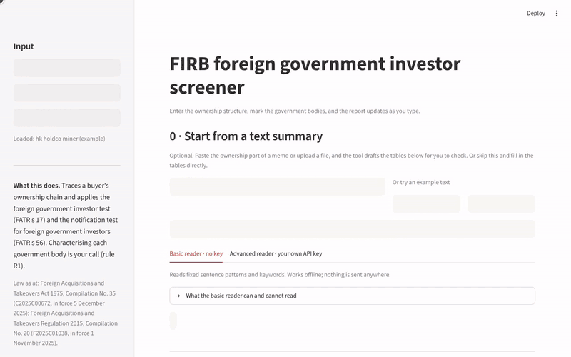

# FIRB FGI Screener

**Is a Chinese acquirer a "foreign government investor" under Australian foreign investment law, and must its deal be notified to FIRB?**

This tool traces a buyer's ownership chain through state-owned holding companies, funds and partnerships, applies the foreign government investor test in the *Foreign Acquisitions and Takeovers Regulation 2015* (FATR s 17) and the notification test for foreign government investors (FATR s 56), and writes a report that cites the provision behind every step.

**Try it:** [firb-fgi-screener.streamlit.app](https://firb-fgi-screener.streamlit.app). No sign-up needed; click *中文* or *English* under "Start from a text summary" for a worked example.



## Why

Whether a buyer is a foreign government investor decides whether almost any acquisition of a direct interest in an Australian entity needs FIRB approval, with no monetary threshold. The answer often sits several layers up: a municipal SASAC that owns 25% of a holding company, which owns 12% of the target; three state funds that each hold under 20% but are associates; a guidance fund that invests through a limited partnership. Working this out by hand means tracing every layer, applying the association and tracing rules, and writing it up. That is about an hour of junior-lawyer time for a simple structure, and errors are easy to make.

The tool does the tracing and the arithmetic, and leaves the judgments to the lawyer.

## What it does

1. **Takes the structure** as three editable tables: entities, holdings, and options or convertibles. It can also draft those tables from a text summary (see below).
2. **Finds every foreign government investor** in the structure, round by round, until nothing changes. This covers direct holdings and associates of the same country (FATA s 6(1)(l)); the 40% test across several countries; distribution entitlements in trusts and limited partnerships (s 11A, s 18(3)); vetoes (s 22(4)); future rights; and the passive-fund exception (FATR s 17(2)).
3. **Traces the buyer's interest in the target** before and after the transaction, attributing a substantial holder's whole holding upward (FATA s 19) and counting each block of shares once.
4. **Decides notification** under FATR s 56, including the direct-interest test (s 16) and the exceptions for new wholly owned subsidiaries, offshore non-material interests, consortium initial interests and passive increases.
5. **Writes a report** in three parts: statutory conclusions with the full chain of reasoning, matters for human judgment, and risk signals for the national interest review. It also draws the ownership structure as a diagram.

## Drafting the tables from text

Paste the ownership part of a memo, or upload a Word, PDF or text file, in Chinese or English.

| Reader | How it works | What it sends |
|---|---|---|
| **Basic** (no key) | Recognises fixed sentence patterns: `A 持有 B 25% 股权`, `A holds 25% of B`, `B is a wholly owned subsidiary of A`, `A 拟收购 B 15%`. Also reads shareholder lists under a heading, defined short names (`以下简称`, `the "Buyer"`) and Word shareholder tables. | Nothing; it runs in the app |
| **Advanced** (your own API key) | A language model reads loosely written or long text. Works with any OpenAI-compatible service (DeepSeek, Qwen, OpenAI and others). | The text, to the service you choose |

Both readers produce a **draft** that you check before it replaces the tables. Every holding keeps the sentence it came from. Statements the reader could not use are listed, so nothing is dropped silently. The advanced reader must quote its source sentence word for word, and a quote that is not in your text is flagged.

Two things are never automated:

- **Government status.** Whether an entity is a foreign government or a separate government entity is the lawyer's call. Every entity read from text starts as `uncertain`. While any entity is uncertain, the result is labelled **provisional**, never "not notifiable".
- **Indirect percentages** ("A 通过 B 间接持有 C 10%") are not read as holdings. They are computed figures, and entering them would count the same shares twice.

## Real structures

`examples/` holds hypothetical teaching cases and two real structures, each with its sources in the file:

- **T19, COFCO / Mengniu / Bellamy's.** From Mengniu's 2025 annual report. No COFCO company holds 20% of Mengniu in its own name: the largest, COFCO Dairy Investments, holds 14.18%. The annual report's substantial-shareholder table shows it at 24.20%, but that is a Hong Kong disclosure figure. It adds subsidiaries' shares and shares under a concert agreement (SFO s 317), so the table's rows overlap and cannot be added. Tracing the chain under FATA gives 24.52%, matching COFCO Corporation's disclosed interest. So Mengniu is a foreign government investor, and its acquisition of Bellamy's is notifiable. A test shows that entering only the largest direct holder gives the wrong answer.
- **T18, Yangtze River Delta VC Guidance Fund.** A RMB 55.1bn limited partnership whose partners are all state entities. Only three partners' contributions are public. The GP is a foreign government investor under FATR s 17(1)(d)(i), whatever the split of the rest. A test checks that the published contributions alone (11.79%) would not be enough.

## Principles

| Rule | What it means in the tool |
|---|---|
| R1 | Characterising a body as FG or SGE is the user's decision, with a reason. The tool never guesses it. |
| R4 | Government-investor status passes down a chain; percentages are not multiplied along it. |
| R5 | Several countries' holdings are aggregated only for the 40% test; the passive-fund exception is checked separately. |
| R6 | Government bodies of the same country are associates; their holdings are added together. |
| R8 | Control without shares, such as acting on a government's wishes, is entered as evidence and counted. |
| R12–R14 | A substantial holder is treated as holding its subsidiary's whole holding (s 19). Each block of target shares is counted once. |
| R15 | A veto over any resolution counts as 20% potential voting power (s 22(4)). |
| R18 | Every holding records its source; figures come from primary documents. |
| R19 | National interest and national security are not assessed, only flagged. |
| R24 | A trustee or general partner is a separate person for each trust or partnership it acts for. |

The rule numbers come from the author's rule book, which records the legal research behind each rule.

## Scope and limits

- **Covered:** foreign government investor status (FATR s 17) and notification of significant actions by foreign government investors (FATR s 56).
- **Not covered:** monetary thresholds for other foreign persons, land, national security businesses, the national interest test, Chinese outbound investment (ODI) approvals, and OCR of scanned documents.
- **Law as at:** *Foreign Acquisitions and Takeovers Act 1975*, Compilation No. 35 (C2025C00672, in force 5 December 2025); *Foreign Acquisitions and Takeovers Regulation 2015*, Compilation No. 20 (F2025C01038, in force 1 November 2025). The 2026 reform proposals are not law. The association and tracing modules are written so they can be replaced if the proposals are enacted.
- **Sellers are not modelled.** When the buyer acquires existing shares from another holder, the seller's reduction is not shown, so the shares after the deal may add up to more than 100%. The tool warns rather than stops. The buyer's own interest is calculated correctly.

## Command line

The same engine runs without the web page, on a YAML description of the structure:

```bash
python -m firb_tracer examples/t19_mengniu_bellamys.yaml -o report.md
```

A minimal input file:

```yaml
title: "Shenzhen SOE buys 25% of a Hong Kong holdco"
buyer: City-SZ_SOE
target: AU_Miner
transaction: {action: acquire_interest, target_is_australian: true, target_is_mining_entity: true}
entities:
  - {id: City-SZ_SASAC, name: "Shenzhen SASAC", kind: government, country: CN, gov_status: FG, gov_reason: "..."}
  - {id: City-SZ_SOE, name: "Shenzhen Resources Group", kind: corporation, country: CN, gov_status: none}
  - {id: HK_HoldCo, name: "HK HoldCo Ltd", kind: corporation, country: HK, gov_status: none}
  - {id: AU_Miner, name: "Australian Miner Ltd", kind: corporation, country: AU, gov_status: none}
holdings:
  - {holder: City-SZ_SASAC, held: City-SZ_SOE, shares_pct: 100, source: "registration record"}
  - {holder: City-SZ_SOE, held: HK_HoldCo, shares_pct: 25, proposed: true, source: "term sheet"}
  - {holder: HK_HoldCo, held: AU_Miner, shares_pct: 12, source: "ASX substantial holder notice"}
```

- **Entities:** `kind` is `government`, `corporation`, `individual`, `trustee` or `general_partner`; `gov_status` is `FG`, `SGE`, `none` or `uncertain`.
- **Holdings:** can also give `voting_pct`, `distribution_pct`, `max_distribution_pct`, `veto`, `board_seats`, `concert_with` and `future_rights`. See the files in `examples/` for each.

## Development

```bash
python3 -m venv .venv && source .venv/bin/activate
pip install -r requirements.txt -e .   # -e . makes `python -m firb_tracer` work
pytest -q              # 142 tests
streamlit run app.py   # the web page, at http://localhost:8501
```

| Path | What it holds |
|---|---|
| `src/firb_tracer/model.py` | Data model, validation, YAML in and out |
| `holdings.py`, `associates.py`, `tracing.py` | FATA s 17, s 6 and s 19 |
| `fgi.py`, `notification.py` | FATR s 17 and s 56 |
| `report.py`, `diagram.py` | Markdown report, Graphviz diagram |
| `text_rules.py`, `llm_extract.py`, `documents.py` | Text readers and file extraction |
| `app.py` | Streamlit web page |
| `tests/` | One test file per module, plus the real cases |

## Disclaimer

This is a screening tool, not legal advice. It applies the jurisdictional rules described above to the facts entered. It does not assess the national interest, and its results depend on the accuracy of those facts and of the user's characterisation of each government body. Confirm any conclusion against the legislation and FIRB guidance before relying on it.

## Author

Casper Chen: PRC-qualified lawyer (Legal Professional Qualification, Class A), LLM (UNSW Sydney). The legal research and rules are the author's. The code was written with an AI coding assistant (Claude), under the author's direction and review.

Licensed under the [MIT License](LICENSE).
